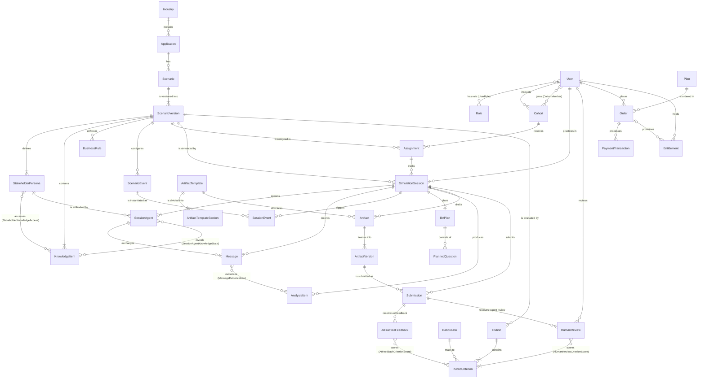

# Tài liệu Phân tích & Thiết kế Dữ liệu (ERD 5 Bước) — Dự án BA-VES

**Đề tài:** Hệ thống mô phỏng doanh nghiệp ảo đa lĩnh vực ứng dụng AI để đào tạo kỹ năng Phân tích nghiệp vụ (*AI-Powered Multi-Domain Virtual Enterprise Simulation for Business Analysis Training — BA-VES*)  
**Mã đề tài:** FA26SE185  
**Giảng viên hướng dẫn:** Thầy Lâm Hữu Khánh Phương  
**Phương pháp áp dụng:** Quy trình xây dựng ERD 5 bước (`Conceptual → Logical → Physical`), Noun Extraction, Quan hệ OOP, Quy tắc 5Đ và DBML.

---

## 1. Đầu vào thiết kế: Phát biểu bài toán, Business Rules & Báo cáo đầu ra

### 1.1. Phát biểu bài toán
> Hệ thống **BA-VES** cung cấp môi trường mô phỏng doanh nghiệp ảo theo nhiều **lĩnh vực** (*Industry*: Ngân hàng, Y tế, Logistics, Giáo dục...) và **ứng dụng doanh nghiệp** (*Application*). Trên mỗi ứng dụng, **giảng viên** (*Instructor*) biên soạn các **kịch bản** (*Scenario*) thông qua từng **phiên bản kịch bản** (*ScenarioVersion*). Mỗi phiên bản kịch bản bao gồm bối cảnh, bài toán nghiệp vụ, các **quy tắc nghiệp vụ** (*BusinessRule*), các **đơn vị tri thức** (*KnowledgeItem*), các **sự kiện tình huống** (*ScenarioEvent* như thay đổi phạm vi, cắt giảm ngân sách) và tập hợp **chân dung các bên liên quan** (*StakeholderPersona*) kèm **quyền tiếp cận tri thức** (*StakeholderKnowledgeAccess*) ẩn/hiện khác nhau.
>
> Giảng viên quản lý các **lớp học phần / nhóm học viên** (*Cohort*), thêm **thành viên lớp** (*CohortMember*) và giao **bài tập thực hành** (*Assignment*) gắn với một phiên bản kịch bản và một **thang đo đánh giá** (*Rubric*). Mỗi thang đo gồm các **tiêu chí đánh giá** (*RubricCriterion*) ánh xạ trực tiếp tới các **nhiệm vụ BABOK** (*BabokTask*) thuộc các **vùng kiến thức BABOK** (*BabokKnowledgeArea*).
>
> Khi **học viên** (*Learner*) bắt đầu làm bài, hệ thống khởi tạo một **phiên mô phỏng** (*SimulationSession*) cùng các **tác tử AI trong phiên** (*SessionAgent*) đóng vai từng Stakeholder với trạng thái tâm lý, độ tin cậy, độ kiên nhẫn và **trạng thái tiết lộ tri thức** (*SessionAgentKnowledgeState*). Học viên lập **kế hoạch phỏng vấn BA** (*BAPlan*) gồm các **câu hỏi dự kiến** (*PlannedQuestion*), trao đổi **tin nhắn hội thoại** (*Message*) với các tác tử AI, nhận các **sự kiện phát sinh trong phiên** (*SessionEvent*), ghi chú các **mục phân tích** (*AnalysisItem*), thiết lập **quan hệ giữa các mục phân tích** (*AnalysisItemRelation*) và gắn **liên kết bằng chứng hội thoại** (*MessageEvidenceLink*).
>
> Sau khi thu thập yêu cầu, học viên soạn thảo **tài liệu BA** (*Artifact*) dựa trên **mẫu tài liệu** (*ArtifactTemplate*) và các **phần mục mẫu** (*ArtifactTemplateSection*), đóng băng thành **phiên bản tài liệu** (*ArtifactVersion*) và gửi **bài nộp** (*Submission*). Hệ thống sinh **phản hồi đánh giá từ AI** (*AIPracticeFeedback*) kèm **điểm AI theo từng tiêu chí** (*AIFeedbackCriterionScore*). Đồng thời, **chuyên gia BA / giảng viên** (*Expert / Instructor*) thực hiện **đánh giá chuyên gia** (*HumanReview*) kèm **điểm chuyên gia theo từng tiêu chí** (*HumanReviewCriterionScore*) để chấm điểm cuối cùng và đối chiếu độ chính xác của AI.
>
> Để mở khóa kịch bản nâng cao và nhận lượt chấm từ chuyên gia, người học có thể đăng ký các **gói cước** (*Plan*) với **phạm vi áp dụng gói** (*PlanScope*), tạo **đơn hàng** (*Order*) và thực hiện **giao dịch thanh toán** (*PaymentTransaction*) qua cổng PayOS; khi thanh toán thành công, hệ thống tự động cấp **quyền truy cập & hạn mức phiên** (*Entitlement*) và ghi nhận biến động số lượt chấm chuyên gia vào **sổ cái tín dụng** (*CreditLedger*). Học viên và giảng viên xem **báo cáo năng lực theo vùng kiến thức BABOK**, **báo cáo thống kê điểm yếu của lớp**, **báo cáo tiến độ khai thác thông tin ẩn** và **báo cáo đối chiếu điểm AI – Chuyên gia**.

---

### 1.2. Danh sách Business Rules (BR)

| Mã | Business Rule | Loại |
| :--- | :--- | :--- |
| **BR-01** | Mỗi lĩnh vực (*Industry*) có mã duy nhất; mỗi ứng dụng (*Application*) có mã duy nhất trong phạm vi một lĩnh vực. | Ràng buộc |
| **BR-02** | Mỗi kịch bản (*Scenario*) có mã duy nhất và gồm nhiều phiên bản (*ScenarioVersion*). Bộ `(ScenarioId, VersionNo)` là duy nhất; phiên bản đã `Published` thì nội dung đóng băng. | Ràng buộc |
| **BR-03** | Trong cùng một `ScenarioVersion`, mã của từng `KnowledgeItem` và mã của từng `BusinessRule` phải là duy nhất. | Ràng buộc |
| **BR-04** | Quyền tiếp cận tri thức (`StakeholderKnowledgeAccess`) chỉ được thiết lập giữa `StakeholderPersona` và `KnowledgeItem` thuộc **cùng một `ScenarioVersion`**. Mỗi cặp `(Persona, KnowledgeItem)` có đúng một mức truy cập (`Knows`, `Partial`, `DoesNotKnow`). | Ràng buộc |
| **BR-05** | Mỗi lớp/nhóm (`Cohort`) có mã duy nhất, ngày kết thúc không nhỏ hơn ngày bắt đầu. Một học viên không được ghi danh hai lần vào cùng một `Cohort`. | Ràng buộc |
| **BR-06** | Mỗi bài tập (`Assignment`) phải giao cho **đúng một đối tượng**: hoặc cả lớp (`CohortId IS NOT NULL, LearnerId IS NULL`) hoặc một học viên cá nhân (`CohortId IS NULL, LearnerId IS NOT NULL`). Số lần thử tối đa (`MaxAttempts`) nếu có phải $> 0$. | Ràng buộc |
| **BR-07** | Mỗi phiên mô phỏng (`SimulationSession`) thuộc một học viên trên một `ScenarioVersion` với số lần thử `AttemptNo > 0`. Nếu làm theo `Assignment` có giới hạn `MaxAttempts`, số phiên không vượt quá `MaxAttempts`. | Ràng buộc |
| **BR-08** | Mỗi tác tử trong phiên (`SessionAgent`) đại diện cho một `StakeholderPersona` **thuộc đúng `ScenarioVersion` của phiên đó**. Các chỉ số tâm lý (`TrustLevel`, `PatienceLevel`, `CooperationLevel`) nằm trong khoảng `0..100`. | Ràng buộc |
| **BR-09** | Mỗi sự kiện nổ ra trong phiên (`SessionEvent`) phải tham chiếu tới một `ScenarioEvent` **thuộc đúng `ScenarioVersion` của phiên đó**, và có thứ tự `SequenceNo` duy nhất trong phiên. | Ràng buộc |
| **BR-10** | Mỗi phiên mô phỏng (`SimulationSession`) có tối đa một kế hoạch phỏng vấn (`BAPlan`); kế hoạch gồm danh sách các câu hỏi dự kiến (`PlannedQuestion`). | Ràng buộc |
| **BR-11** | Trong một phiên, mỗi mục phân tích (`AnalysisItem`) có mã `Code` duy nhất. Một mục phân tích không được tự liên kết với chính nó (`SourceAnalysisItemId <> TargetAnalysisItemId`), và hai mục liên kết phải thuộc cùng một phiên. | Ràng buộc |
| **BR-12** | Liên kết bằng chứng (`MessageEvidenceLink`) chỉ được nối giữa một `Message` và một `AnalysisItem` thuộc **cùng một `SimulationSession`**. | Ràng buộc |
| **BR-13** | Mỗi bài nộp (`Submission`) trong một phiên phải có `AttemptNo` duy nhất và chỉ được tham chiếu tới một `ArtifactVersion` đóng băng thuộc đúng `SimulationSession` đó. | Ràng buộc |
| **BR-14** | Khung năng lực BABOK gồm các `BabokKnowledgeArea` (mã duy nhất) và các `BabokTask` (mã duy nhất theo từng `BabokVersion`). | Ràng buộc |
| **BR-15** | Mỗi `Rubric` thuộc một `ScenarioVersion`, có số `Version` duy nhất trong phiên bản kịch bản đó. Mỗi tiêu chí (`RubricCriterion`) gắn với một `BabokTask`, có `Weight > 0` và `MaxScore > 0`. | Ràng buộc |
| **BR-16** | Mỗi lần chấm của AI (`AIPracticeFeedback`) và của Chuyên gia (`HumanReview`) chấm điểm chi tiết trên từng `RubricCriterion` **thuộc đúng bộ `Rubric`** được dùng cho lần chấm đó. Độ tự tin của AI (`Confidence`) nằm trong `[0, 1]`. | Ràng buộc |
| **BR-17** | Điểm trung bình chuẩn của chuyên gia (*Expert Reference Score*) và tỷ lệ thành thạo theo từng vùng kiến thức BABOK là **thuộc tính dẫn xuất**, được tính từ điểm của các tiêu chí thành phần, không lưu thành bảng báo cáo cố định. | Suy diễn / Tính toán |
| **BR-18** | Mỗi gói cước (`Plan`) có mã `Code` duy nhất và giá `Price >= 0`, xác định các phạm vi mở khóa (`PlanScope`: `Industry`, `Application`, `Scenario`, `All`), hạn mức phiên (`SessionQuota`) và số lượt chấm (`ReviewCredits`). | Ràng buộc |
| **BR-19** | Mỗi đơn hàng (`Order`) có mã số `OrderCode` duy nhất gửi sang cổng thanh toán PayOS. Mỗi giao dịch thanh toán (`PaymentTransaction`) có bộ `(Provider, ProviderTransactionId)` duy nhất để chống xử lý trùng lặp (*Idempotency*). | Ràng buộc |
| **BR-20** | Khi đơn hàng chuyển sang `Paid`, hệ thống cấp quyền truy cập (`Entitlement`) và cộng lượt chấm vào sổ cái (`CreditLedger`). Học viên chỉ được bắt đầu phiên khi có `Entitlement` hợp lệ (`Active`, còn hạn và `SessionsUsed < SessionQuota`). | Quy trình / Ràng buộc |

---

### 1.3. Báo cáo đầu ra (Kiểm chứng thiết kế ở Bước 5)

| Báo cáo | Người xem | Nội dung cần truy vấn |
| :--- | :--- | :--- |
| **1. Biểu đồ Radar năng lực theo BABOK Knowledge Area** | Learner, Instructor | Điểm thành thạo (%) có trọng số của học viên trên từng vùng kiến thức BABOK qua các bài nộp đã chấm. |
| **2. Thống kê năng lực lớp (Cohort) & Điểm yếu theo BABOK Task** | Instructor | Điểm trung bình của cả lớp theo từng `BabokKnowledgeArea` & `BabokTask`; số lượng học viên dưới ngưỡng đạt ($< 50\%$). |
| **3. Báo cáo đối chiếu điểm AI vs. Chuyên gia BA (Calibration)** | Instructor, Expert, Researcher | So sánh điểm từng tiêu chí của AI với điểm trung bình của các chuyên gia BA (`ExpertReferenceScore`), độ lệch giữa các chuyên gia (`Spread`) và sai số tuyệt đối (`MAE`). |
| **4. Báo cáo tiến độ khai thác thông tin ẩn (Elicitation Progress)** | Learner, Instructor | Tỷ lệ thông tin ẩn/tri thức (`KnowledgeItem`) đã được học viên khai thác thành công (`IsRevealed = 1`) từ từng Stakeholder trong phiên cùng các chỉ số `Trust`, `Patience`, `Cooperation`. |

---

## 2. Bước 1 — Noun Extraction & Lọc thực thể

Áp dụng 4 câu hỏi lọc thực thể (Mục 5.2 tài liệu hướng dẫn):
1. **Lưu trữ:** Hệ thống có cần nhớ thông tin về nó không?
2. **Nhiều bản ghi:** Có nhiều cá thể khác nhau của nó không?
3. **Có thuộc tính riêng:** Có ít nhất 1 thuộc tính định danh và 1 thuộc tính mô tả khác không?
4. **Trong phạm vi:** Có thuộc Scope của đề tài BA-VES không?

### 2.1. Bảng trích xuất và lọc danh từ / động từ

| Danh từ / Động từ trong bài toán | Quyết định | Lý do (Theo 4 câu hỏi lọc & OOP) | Thực thể / Thành phần |
| :--- | :--- | :--- | :--- |
| Hệ thống BA-VES | **Loại** | Chính hệ thống đang xây dựng (chỉ có 1). | — |
| Người dùng (Chung) | **Giữ** | Học viên, Giảng viên, Chuyên gia, Admin đều đăng nhập và thao tác. | `User` |
| Vai trò (Admin, Instructor, Expert, Learner) | **Giữ** | Hệ thống cho phép một người dùng đảm nhận nhiều vai trò (VD: vừa là Instructor vừa là Expert chấm chéo), có trạng thái kích hoạt và lịch sử gán quyền. | `Role`, `UserRole` |
| Lĩnh vực doanh nghiệp | **Giữ** | Nhiều lĩnh vực (Banking, Healthcare, Logistics...), có mã, tên, thứ tự. | `Industry` |
| Ứng dụng doanh nghiệp | **Giữ** | Nhiều hệ thống nghiệp vụ trong mỗi lĩnh vực, có mã, mô tả, trạng thái. | `Application` |
| Kịch bản mô phỏng | **Giữ** | Nhiều kịch bản, có mã, tiêu đề, người tạo, vòng đời. | `Scenario` |
| Phiên bản kịch bản | **Giữ** | Một kịch bản có nhiều phiên bản (`v1`, `v2`...) với bối cảnh, bài toán, độ khó riêng. | `ScenarioVersion` |
| Quy tắc nghiệp vụ (của kịch bản) | **Giữ** | Nhiều quy tắc ẩn/hiện trong một phiên bản kịch bản. | `BusinessRule` |
| Đơn vị tri thức | **Giữ** | Các mảnh thông tin nghiệp vụ cần khai thác trong kịch bản. | `KnowledgeItem` |
| Chân dung bên liên quan | **Giữ** | Nhiều nhân vật AI trong kịch bản, có vai trò, phòng ban, mục tiêu, nỗi đau, tính cách. | `StakeholderPersona` |
| Tiếp cận / Nắm giữ tri thức | **Giữ (Association class)** | Quan hệ N:N giữa `StakeholderPersona` và `KnowledgeItem`, sinh dữ liệu riêng (`AccessType`, `DisclosureRule`, `IsHidden`). | `StakeholderKnowledgeAccess` |
| Sự kiện tình huống (mẫu) | **Giữ** | Các biến cố cấu hình sẵn trong kịch bản (đổi scope, cắt ngân sách...). | `ScenarioEvent` |
| Lớp học phần / Nhóm học viên | **Giữ** | Nhiều lớp/nhóm thực hành, có mã, ngày bắt đầu/kết thúc, giảng viên phụ trách. | `Cohort` |
| Ghi danh vào lớp | **Giữ (Association class)** | Quan hệ N:N giữa `Cohort` và `User (Learner)`, có ngày vào lớp và trạng thái. | `CohortMember` |
| Bài tập giao | **Giữ** | Giao kịch bản cho lớp hoặc cá nhân kèm hạn nộp và số lần thử. | `Assignment` |
| Phiên mô phỏng | **Giữ** | Thực thể trung tâm ghi nhận mỗi lượt thực hành của học viên. | `SimulationSession` |
| Tác tử AI trong phiên | **Giữ** | Trạng thái động của từng `StakeholderPersona` trong một phiên cụ thể (`TrustLevel`, `PatienceLevel`, `MemorySummary`). | `SessionAgent` |
| Tin nhắn hội thoại | **Giữ** | Từng lượt trao đổi giữa học viên và tác tử AI trong phiên. | `Message` |
| Sự kiện phát sinh trong phiên | **Giữ** | Ghi nhận thời điểm và thứ tự một `ScenarioEvent` thực sự nổ ra trong phiên. | `SessionEvent` |
| Tiết lộ tri thức trong phiên | **Giữ (Association class)** | Quan hệ N:N giữa `SessionAgent` và `KnowledgeItem`, lưu trạng thái đã tiết lộ (`IsRevealed`), thời điểm và tin nhắn tiết lộ. | `SessionAgentKnowledgeState` |
| Kế hoạch phỏng vấn BA | **Giữ** | Bản kế hoạch mục tiêu và cách tiếp cận của học viên cho phiên. | `BAPlan` |
| Câu hỏi dự kiến | **Giữ** | Danh sách câu hỏi chuẩn bị trước thuộc `BAPlan`. | `PlannedQuestion` |
| Mục phân tích | **Giữ** | Các Finding, Requirement, Risk, Conflict... học viên bóc tách được trong phiên. | `AnalysisItem` |
| Liên hệ giữa các mục phân tích | **Giữ (Association class)** | Quan hệ tự thân N:N giữa các `AnalysisItem` (`Derives`, `ConflictsWith`...). | Gắn bằng chứng hội thoại | **Giữ (Association class)** | Quan hệ N:N giữa `Message` và `AnalysisItem` kèm loại bằng chứng (`Supports`, `Contradicts`...). | `MessageEvidenceLink` |
| Mẫu tài liệu BA | **Giữ** | Mẫu BRD/Generic chuẩn do hệ thống định nghĩa. | `ArtifactTemplate` |
| Phần mục của mẫu tài liệu | **Giữ** | Các mục con (`Section`) bắt buộc/tùy chọn trong mẫu tài liệu. | `ArtifactTemplateSection` |
| Tài liệu BA (bản nháp đang soạn) | **Giữ** | Tài liệu học viên soạn thảo trong phiên theo một mẫu. | `Artifact` |
| Phiên bản tài liệu đóng băng | **Giữ** | Bản snapshot của `Artifact` tại từng lần lưu phiên bản. | `ArtifactVersion` |
| Bài nộp | **Giữ** | Lượt nộp một `ArtifactVersion` để chấm điểm trong phiên. | `Submission` |
| Vùng kiến thức BABOK | **Giữ** | 6 vùng kiến thức chuẩn của BABOK v3. | Nhiệm vụ BABOK | **Giữ** | Các Task cụ thể thuộc từng vùng kiến thức BABOK. | `BabokTask` |
| Thang đo đánh giá (Rubric) | **Giữ** | Bộ tiêu chí chấm cho một `ScenarioVersion`. | `Rubric` |
| Tiêu chí đánh giá | **Giữ** | Từng tiêu chí thành phần thuộc `Rubric`, gắn với `BabokTask`, có trọng số và điểm tối đa. | `RubricCriterion` |
| Phản hồi đánh giá từ AI | **Giữ** | Lượt chấm tự động của AI cho một `Submission`. | `AIPracticeFeedback` |
| Điểm AI theo từng tiêu chí | **Giữ (Association class)** | Kết quả chấm của AI trên từng `RubricCriterion` (tách từ JSON để đạt 3NF). | `AIFeedbackCriterionScore` |
| Đánh giá của chuyên gia | **Giữ** | Lượt chấm thẩm định của một Chuyên gia/Giảng viên cho một `Submission`. | `HumanReview` |
| Điểm chuyên gia theo từng tiêu chí | **Giữ (Association class)** | Kết quả chấm của chuyên gia trên từng `RubricCriterion` (tách từ JSON để đạt 3NF). | `HumanReviewCriterionScore` |
| Gói cước thương mại | **Giữ** | Các gói Free, ScenarioBundle, Subscription, ReviewCredit có giá, thời hạn, hạn mức. | `Plan` |
| Phạm vi mở khóa của gói cước | **Giữ** | Một gói cước có thể mở khóa nhiều phạm vi (`Industry`, `Application`, `Scenario`, `All`). | Đơn hàng thanh toán | **Giữ** | Đơn đặt mua gói cước của người dùng kèm mã `OrderCode` và link QR PayOS. | `Order` |
| Giao dịch thanh toán | **Giữ** | Bản ghi giao dịch trả về từ cổng PayOS gắn với đơn hàng. | `PaymentTransaction` |
| Sự kiện Webhook kỹ thuật | **Loại ở Conceptual/Logical (Chỉ giữ ở Physical)** | Bảng kỹ thuật thuần túy lưu hash payload chống lặp webhook (`PaymentWebhookEvent`). | `PaymentWebhookEvent` *(Physical)* |
| Quyền truy cập & hạn mức phiên | **Giữ** | Quyền sử dụng kịch bản có thời hạn và bộ đếm `SessionsUsed / SessionQuota` của người học. | `Entitlement` |
| Sổ cái tín dụng chấm bài | **Giữ** | Lịch sử cộng/trừ số lượt yêu cầu chuyên gia chấm bài (`Delta`, `Reason`). | Biểu đồ Radar, Báo cáo thống kê lớp, Điểm trung bình chuyên gia, Số dư Credit hiện tại | **Loại (Báo cáo / Dẫn xuất)** | Là kết quả truy vấn (`VIEW` / `SUM(Delta)`) từ dữ liệu gốc, không tạo bảng lưu trữ. | — |

> [!NOTE]
> **Giải trình về thực thể `User` và `Role` (Mục 5.2 & 8.3):** Trong phạm vi BA-VES MVP, Học viên (`Learner`), Giảng viên (`Instructor`) và Chuyên gia (`Expert`) không có tập thuộc tính hồ sơ riêng biệt mà dùng chung thông tin định danh trên `User` và phân biệt qua `Role`/`UserRole`. Ngoài ra, một người dùng có thể vừa đóng vai trò `Instructor` vừa đóng vai trò `Expert`. Do đó, mô hình hóa bằng quan hệ `User – UserRole – Role` phù hợp hơn tách bảng kế thừa cứng. (Ở mức Physical, 4 bảng kỹ thuật xác thực của ASP.NET Identity gồm `RoleClaims`, `UserClaims`, `UserLogins`, `UserTokens` được bổ sung để phục vụ tầng bảo mật).

---

## 3. Bước 2 — Xác định thuộc tính theo Quy tắc 5Đ

Với mỗi thực thể, rà soát đủ 5 nhóm thuộc tính: **Định danh, Định tính, Định lượng, Định thời, Định trạng**. Nhóm nào trống (`—`) đều có giải thích rõ lý do nghiệp vụ.

### 3.1. Bảng 5Đ tổng hợp cho các thực thể cốt lõi

| Thực thể | 1. Định danh | 2. Định tính | 3. Định lượng | 4. Định thời | 5. Định trạng |
| :--- | :--- | :--- | :--- | :--- | :--- |
| **User** | `Id`, `Email` (UK), `UserName` (UK) | `FullName`, `AvatarUrl`, `PhoneNumber` | `AccessFailedCount` | `CreatedAt`, `UpdatedAt`, `LockoutEnd` | `Status` (`Active`, `Suspended`, `Archived`) |
| **Role** | `Id`, `Name` (UK) | `Description` | — *(Danh mục vai trò không có đại lượng đo)* | `CreatedAt` | `IsActive` |
| **UserRole** | `(UserId, RoleId)` (PK) | — *(Bảng gán quyền thuần túy)* | — | `AssignedAt` | — *(Hết quyền thì thu hồi dòng gán)* |
| **Industry** | `Id`, `Code` (UK) | `Name`, `Description` | `DisplayOrder` | `CreatedAt`, `UpdatedAt` | `Status` (`Active`, `Inactive`, `Archived`) |
| **Application** | `Id`; `(IndustryId, Code)` (UK) | `Name`, `Description` | `DisplayOrder` | `CreatedAt`, `UpdatedAt` | `Status` (`Active`, `Inactive`, `Archived`) |
| **Scenario** | `Id`, `Code` (UK) | `Title`, `Description` | — *(Số phiên bản đếm từ `ScenarioVersion`)* | `CreatedAt`, `UpdatedAt` | `Status` (`Draft`, `Published`, `Archived`) |
| **ScenarioVersion** | `Id`; `(ScenarioId, VersionNo)` (UK) | `Summary`, `BusinessContext`, `BusinessProblem`, `BusinessObjectives`, `BARole`, `Assignment`, `InScope`, `OutOfScope`, `KnownConstraints`, `Difficulty` | `VersionNo` | `CreatedAt`, `PublishedAt` | `Status` (`Draft`, `Published`, `Archived`) |
| **StakeholderPersona** | `Id` | `Name`, `StakeholderRole`, `Department`, `Responsibilities`, `Goals`, `PainPoints`, `BusinessConcerns`, `CommunicationStyle`, `Personality` | `DisplayOrder` | — *(Đi theo mốc thời gian của `ScenarioVersion`)* | `IsActive` |
| **KnowledgeItem** | `Id`; `(ScenarioVersionId, Code)` (UK) | `Title`, `Content`, `Category`, `Importance` | — | `CreatedAt` | — *(Vòng đời phụ thuộc `ScenarioVersion`)* |
| **StakeholderKnowledgeAccess** | `(StakeholderPersonaId, KnowledgeItemId)` (UK) | `AccessType` (`Knows`, `Partial`, `DoesNotKnow`), `DisclosureRule` | — | — | `IsHidden` |
| **BusinessRule** | `Id`; `(ScenarioVersionId, Code)` (UK) | `Title`, `Description`, `Importance` | — | — | `IsHidden` |
| **ScenarioEvent** | `Id` | `Title`, `Description`, `TriggerType`, `TriggerConditionJson`, `EventContent` | `DisplayOrder` | — | `IsActive` |
| **Cohort** | `Id`, `Code` (UK) | `Name`, `Description` | — *(Sĩ số đếm từ `CohortMember`)* | `StartDate`, `EndDate`, `CreatedAt`, `UpdatedAt` | `Status` (`Draft`, `Active`, `Completed`, `Archived`) |
| **CohortMember** | `Id`; `(CohortId, LearnerId)` (UK) | — | — | `JoinedAt` | `Status` (`Active`, `Removed`, `Completed`) |
| **Assignment** | `Id` | `Title`, `Instructions` | `MaxAttempts` | `StartAt`, `DueAt`, `CreatedAt`, `UpdatedAt` | `Status` (`Draft`, `Scheduled`, `Active`, `Closed`, `Archived`) |
| **SimulationSession** | `Id` | — | `AttemptNo` | `StartedAt`, `SubmittedAt`, `CompletedAt` | `Status` (`Active`, `Submitted`, `Completed`, `Abandoned`) |
| **SessionAgent** | `Id`; `(SessionId, PersonaId)` (UK) | `MemorySummary`, `CurrentMood` | `TrustLevel`, `PatienceLevel`, `CooperationLevel` (`0..100`) | `LastInteractionAt` | `IsActive` |
| **Message** | `Id` | `SenderType` (`Learner`, `Stakeholder`, `System`), `Content` | — | `CreatedAt` | — *(Tin nhắn là nhật ký bất biến)* |
| **SessionEvent** | `Id`; `(SessionId, SequenceNo)` (UK) | `TriggerSource`, `EventContentSnapshot` | `SequenceNo` | `TriggeredAt` | — *(Sự kiện đã phát sinh là bất biến)* |
| **SessionAgentKnowledgeState** | `Id`; `(SessionAgentId, KnowledgeItemId)` (UK) | — | — | `RevealedAt` | `IsRevealed` |
| **BAPlan** | `Id`, `SessionId` (UK) | `Objective`, `Approach` | — | `CreatedAt`, `UpdatedAt` | `Status` (`Draft`, `Ready`, `InProgress`, `Completed`) |
| **PlannedQuestion** | `Id` | `Topic`, `InformationNeed`, `Question`, `Priority` | `DisplayOrder` | `CreatedAt` | `Status` (`Planned`, `Asked`, `Skipped`) |
| **AnalysisItem** | `Id`; `(SessionId, Code)` (UK) | `ItemType`, `Title`, `Description`, `Priority`, `MetadataJson` | — | `CreatedAt`, `UpdatedAt` | `Status` (`Draft`, `Confirmed`, `Resolved`, `Archived`) |
| **AnalysisItemRelation** | `Id`; `(SourceId, TargetId, Type)` (UK) | `RelationshipType`, `Notes` | — | `CreatedAt` | — |
| **MessageEvidenceLink** | `Id`; `(MessageId, AnalysisItemId, Type)` (UK) | `RelationshipType` (`Supports`, `Contradicts`, `Clarifies`, `Confirms`) | — | `CreatedAt` | — |
| **ArtifactTemplate** | `Id`, `Code` (UK) | `Name`, `ArtifactType`, `Description` | — | `CreatedAt`, `UpdatedAt` | `Status` (`Draft`, `Published`, `Archived`) |
| **ArtifactTemplateSection** | `Id`; `(ArtifactTemplateId, SectionKey)` (UK) | `SectionKey`, `Title`, `Instructions` | `DisplayOrder` | — | `IsRequired` |
| **Artifact** | `Id` | `Title`, `DraftStructuredContentJson`, `DraftPlainTextContent` | `CurrentVersionNo` | `CreatedAt`, `UpdatedAt` | `Status` (`Draft`, `ReadyForSubmission`, `Submitted`) |
| **ArtifactVersion** | `Id`; `(ArtifactId, VersionNo)` (UK) | `StructuredContentJson`, `PlainTextContent` | `VersionNo` | `CreatedAt` | `ProcessingStatus` (`Created`, `Processing`, `Ready`, `Failed`) |
| **Submission** | `Id`; `(SessionId, AttemptNo)` (UK) | — | `AttemptNo` | `SubmittedAt`, `FinalizedAt` | `Status` (`Submitted`, `Finalized`, `Withdrawn`) |
| **BabokKnowledgeArea** | `Id`, `Code` (UK) | `Name`, `Description`, `BabokVersion` | `DisplayOrder` | — *(Danh mục chuẩn quốc tế)* | — |
| **BabokTask** | `Id`; `(BabokVersion, Code)` (UK) | `Name`, `Purpose`, `Description`, `BabokVersion` | `DisplayOrder` | — | — |
| **Rubric** | `Id`; `(ScenarioVersionId, Version)` (UK) | `Name`, `Description` | `Version` | `CreatedAt`, `UpdatedAt` | `Status` (`Draft`, `Published`, `Archived`) |
| **RubricCriterion** | `Id`; `(RubricId, Code)` (UK) | `Name`, `Description`, `EvidenceGuidance` | `Weight`, `MaxScore`, `DisplayOrder` | — | `IsRequired` |
| **AIPracticeFeedback** | `Id` | `Provider`, `Model`, `OverallFeedback` | `SuggestedScore`, `Confidence` (`0..1`) | `StartedAt`, `CompletedAt` | `Status` (`Pending`, `Processing`, `Completed`, `Failed`) |
| **AIFeedbackCriterionScore** | `(AIFeedbackId, RubricCriterionId)` (PK) | `Comment`, `EvidenceSnippet` | `Score` | — *(Theo mốc của `AIPracticeFeedback`)* | — |
| **HumanReview** | `Id`; `(SubmissionId, ReviewerId)` (UK) | `OverallFeedback` | `FinalScore` | `ReviewedAt` | — *(Bản chấm đã lưu là hoàn tất)* |
| **HumanReviewCriterionScore** | `(HumanReviewId, RubricCriterionId)` (PK) | `Comment` | `Score` | — *(Theo mốc của `HumanReview`)* | — |
| **Plan** | `Id`, `Code` (UK) | `Name`, `Description`, `PlanType`, `Currency` | `Price`, `DurationDays`, `SessionQuota`, `ReviewCredits`, `DisplayOrder` | `CreatedAt` | `Status` (`Draft`, `Published`, `Archived`) |
| **PlanScope** | `Id` | `ScopeType` (`Industry`, `Application`, `Scenario`, `All`) | `ScopeId` | — *(Đi theo `Plan`)* | — |
| **Order** | `Id`, `OrderCode` (UK), `IdempotencyKey` | `Currency`, `PlanSnapshotJson`, `CheckoutUrl`, `QrCode` | `Amount` | `CreatedAt`, `ExpiresAt`, `PaidAt`, `CancelledAt` | `Status` (`Pending`, `Paid`, `Cancelled`, `Expired`, `Failed`, `Refunded`) |
| **PaymentTransaction** | `Id`; `(Provider, ProviderTransactionId)` (UK) | `Provider`, `RawPayloadJson` | `Amount` | `ReceivedAt` | `Status` (`Pending`, `Succeeded`, `Failed`), `SignatureValid` |
| **Entitlement** | `Id` | `SourceType`, `ScopeType` | `ScopeId`, `SessionQuota`, `SessionsUsed` | `StartsAt`, `EndsAt`, `CreatedAt` | `Status` (`Active`, `Expired`, `Revoked`) |
| **CreditLedger** | `Id` | `Reason` (`Purchase`, `ReviewRequest`, `Refund`, `AdminAdjustment`), `Note` | `Delta` | `CreatedAt` | — *(Sổ cái bất biến)* |

---

## 4. Bước 3 — Quan hệ OOP & Conceptual ERD

### 4.1. Bảng quan hệ hướng đối tượng

| Thực thể A | Quan hệ | Thực thể B | Bản số A : B | Kiểu OOP | Căn cứ BR |
| :--- | :--- | :--- | :--- | :--- | :--- |
| `User` | đảm nhận | `Role` | `0..N : 0..N` (qua `UserRole`) | Association class | Phân quyền RBAC |
| `Industry` | gồm | `Application` | `1 : 0..N` | Aggregation | BR-01 |
| `Application` | có kịch bản | `Scenario` | `1 : 0..N` | Association | BR-01, BR-02 |
| `Scenario` | chia thành | `ScenarioVersion` | `1 : 1..N` | **Composition** | BR-02 |
| `ScenarioVersion` | chứa | `StakeholderPersona` | `1 : 1..N` | **Composition** | BR-02, BR-04 |
| `ScenarioVersion` | chứa | `KnowledgeItem` | `1 : 1..N` | **Composition** | BR-03 |
| `ScenarioVersion` | chứa | `BusinessRule` | `1 : 0..N` | **Composition** | BR-03 |
| `ScenarioVersion` | chứa | `ScenarioEvent` | `1 : 0..N` | **Composition** | BR-09 |
| `StakeholderPersona` | tiếp cận | `KnowledgeItem` | `0..N : 0..N` (qua `StakeholderKnowledgeAccess`) | Association class | BR-04 |
| `User` (Instructor) | phụ trách | `Cohort` | `1 : 0..N` | Association | BR-05 |
| `User` (Learner) | tham gia | `Cohort` | `0..N : 0..N` (qua `CohortMember`) | Association class | BR-05 |
| `ScenarioVersion` | được giao qua | `Assignment` | `1 : 0..N` | Association | BR-06 |
| `ScenarioVersion` | được thực hành tại | `SimulationSession` | `1 : 0..N` | Association | BR-07 |
| `User` (Learner) | thực hiện | `SimulationSession` | `1 : 0..N` | Association | BR-07 |
| `SimulationSession` | khởi tạo | `SessionAgent` | `1 : 1..N` | **Composition** | BR-08 |
| `SimulationSession` | ghi nhận | `Message` | `1 : 0..N` | **Composition** | BR-12 |
| `SimulationSession` | phát sinh | `SessionEvent` | `1 : 0..N` | **Composition** | BR-09 |
| `SessionAgent` | tiết lộ | `KnowledgeItem` | `0..N : 0..N` (qua `SessionAgentKnowledgeState`) | Association class | BR-04, BR-08 |
| `SimulationSession` | có kế hoạch | `BAPlan` | `1 : 0..1` | **Composition** | BR-10 |
| `BAPlan` | gồm | `PlannedQuestion` | `1 : 0..N` | **Composition** | BR-10 |
| `SimulationSession` | bóc tách | `AnalysisItem` | `1 : 0..N` | **Composition** | BR-11 |
| `Message` | làm bằng chứng cho | `AnalysisItem` | `0..N : 0..N` (qua `MessageEvidenceLink`) | Association class | BR-12 |
| `ArtifactTemplate` | chia thành | `ArtifactTemplateSection` | `1 : 1..N` | **Composition** | Cấu trúc mẫu |
| `SimulationSession` | soạn thảo | `Artifact` | `1 : 0..N` | **Composition** | BR-13 |
| `Artifact` | lưu thành | `ArtifactVersion` | `1 : 1..N` | **Composition** | BR-13 |
| `ArtifactVersion` | được nộp qua | `Submission` | `1 : 0..N` | Association | BR-13 |
| `ScenarioVersion` | đánh giá bằng | `Rubric` | `1 : 0..N` | Association | BR-15 |
| `Rubric` | chia thành | `RubricCriterion` | `1 : 1..N` | **Composition** | BR-15 |
| `BabokTask` | được đo bởi | `RubricCriterion` | `1 : 0..N` | Association | BR-15 |
| `Submission` | được AI chấm | `AIPracticeFeedback` | `1 : 0..N` | **Composition** | BR-16 |
| `AIPracticeFeedback` | chấm chi tiết | `RubricCriterion` | `0..N : 1..N` (qua `AIFeedbackCriterionScore`) | Association class | BR-16 |
| `Submission` | được chuyên gia chấm | `HumanReview` | `1 : 0..N` | **Composition** | BR-16 |
| `HumanReview` | chấm chi tiết | `RubricCriterion` | `0..N : 1..N` (qua `HumanReviewCriterionScore`) | Association class | BR-16 |
| `Plan` | áp dụng cho | `User` (Learner) | đặt mua | `Order` | `1 : 0..N` | Association | BR-19 |
| `Plan` | được đặt trong | `Order` | `1 : 0..N` | Association | BR-18, BR-19 |
| `Order` | ghi nhận giao dịch | `PaymentTransaction` | `1 : 0..N` | **Composition** | BR-19 |
| `User` (Learner) | sở hữu quyền | `Entitlement` | `1 : 0..N` | Association | BR-20 |
| `Order` | cấp quyền | `Entitlement` | `0..1 : 0..N` | Association | BR-20 |
| `User` (Learner) | biến động tín dụng | `Order` | sinh tín dụng | `Submission` | tiêu tốn tín dụng 
---

### 4.2. Sơ đồ Conceptual ERD (Mức khái niệm — Không khóa ngoại, không kiểu dữ liệu)

---

## 5. Bước 4 — Logical ERD, Chuẩn hóa 3NF & Ràng buộc xuyên quan hệ

### 5.1. Chuẩn hóa 1NF – 3NF & Khắc phục lỗi lưu mảng điểm trong JSON

| Chuẩn | Vấn đề trong bản MVP cũ | Cách chuẩn hóa trong bản ERD mới |
| :--- | :--- | :--- |
| **1NF** *(Mỗi ô một giá trị đơn, không lưu danh sách lặp)* | `AIPracticeFeedbacks.FeedbackItemsJson` và `HumanReviews.CriterionResultsJson` lưu toàn bộ mảng điểm của 10–20 tiêu chí Rubric vào một ô chuỗi JSON. | Tách thành 2 bảng trung gian chuẩn: **`AIFeedbackCriterionScores`** `(AIFeedbackId, RubricCriterionId, Score, Comment)` và **`HumanReviewCriterionScores`** `(HumanReviewId, RubricCriterionId, Score, Comment)`. |
| **2NF** *(Mọi cột không khóa phụ thuộc đầy đủ vào toàn bộ khóa ghép)* | Không lưu `CriterionName`, `BabokTaskName` hay `LearnerName` vào bảng điểm chi tiết. | Lấy tên tiêu chí và vùng kiến thức BABOK qua `JOIN RubricCriteria -> BabokTasks -> BabokKnowledgeAreas`. |
| **3NF & Thuộc tính dẫn xuất** *(Không phụ thuộc bắc cầu, không lưu cứng báo cáo)* | Điểm trung bình của các chuyên gia (`ExpertReferenceScore`), tỷ lệ hoàn thành BABOK Knowledge Area (`MasteryPercentage`) và tỷ lệ khai thác tri thức ẩn (`ElicitationCoveragePct`) nếu lưu cứng sẽ lệch khi chuyên gia chấm bổ sung. | Tính động qua 4 `VIEW` ở Bước 5; hoàn toàn không lưu dư thừa. |

---

### 5.2. Ràng buộc xuyên quan hệ bằng Khóa ngoại ghép (Áp dụng Mục 8.4 của thầy)

Trong một hệ thống mô phỏng đa kịch bản, nếu chỉ dùng FK đơn thông thường (`SessionId` riêng, `PersonaId` riêng), CSDL vẫn cho phép chèn dữ liệu **lệch ngữ cảnh** (ví dụ: phiên đang chạy kịch bản *Ngân hàng* nhưng lại gắn `StakeholderPersona` của kịch bản *Bệnh viện*).

Để chặn triệt để ở mức CSDL giống như cách thầy dùng FK ghép cho bảng `Attendance` trong mục 8.4, thiết kế đã áp dụng **6 cặp FK ghép**:

1. **Ràng buộc Stakeholder và Tri thức cùng phiên bản kịch bản (`StakeholderKnowledgeAccess`):**
   * `(StakeholderPersonaId, ScenarioVersionId) → StakeholderPersonas(Id, ScenarioVersionId)`
   * `(KnowledgeItemId, ScenarioVersionId) → KnowledgeItems(Id, ScenarioVersionId)`
2. **Ràng buộc Tác tử AI thuộc đúng kịch bản của phiên (`SessionAgents`):**
   * `(SessionId, ScenarioVersionId) → SimulationSessions(Id, ScenarioVersionId)`
   * `(PersonaId, ScenarioVersionId) → StakeholderPersonas(Id, ScenarioVersionId)`
3. **Ràng buộc Sự kiện phát sinh thuộc đúng kịch bản của phiên (`SessionEvents`):**
   * `(SessionId, ScenarioVersionId) → SimulationSessions(Id, ScenarioVersionId)`
   * `(ScenarioEventId, ScenarioVersionId) → ScenarioEvents(Id, ScenarioVersionId)`
4. **Ràng buộc Tin nhắn bằng chứng và Mục phân tích thuộc cùng một phiên (`MessageEvidenceLinks`):**
   * `(MessageId, SessionId) → Messages(Id, SessionId)`
   * `(AnalysisItemId, SessionId) → AnalysisItems(Id, SessionId)`
5. **Ràng buộc Bài nộp chỉ nộp Phiên bản tài liệu của đúng phiên đó (`Submissions`):**
   * `(ArtifactId, SessionId) → Artifacts(Id, SessionId)` (trên `ArtifactVersions`)
   * `(ArtifactVersionId, SessionId) → ArtifactVersions(Id, SessionId)` (trên `Submissions`)
6. **Ràng buộc Điểm tiêu chí thuộc đúng bộ Rubric được dùng chấm bài (`AIFeedbackCriterionScores` & `HumanReviewCriterionScores`):**
   * `(AIFeedbackId, RubricId) → AIPracticeFeedbacks(Id, RubricId)` và `(RubricCriterionId, RubricId) → RubricCriteria(Id, RubricId)`
   * `(HumanReviewId, RubricId) → HumanReviews(Id, RubricId)` và `(RubricCriterionId, RubricId) → RubricCriteria(Id, RubricId)`

*(File DBML mức Logical nằm tại: [baves_logical.dbml](file:///d:/backend/docs/erd/baves_logical.dbml))*

---

## 6. Bước 5 — Physical ERD, Thực thi Business Rules & Truy vấn Báo cáo

*(File DBML mức Physical nằm tại: [baves_physical.dbml](file:///d:/backend/docs/erd/baves_physical.dbml) — File SQL chuẩn hóa nằm tại: [BA-VES-ERD-Standardized.sql](file:///d:/backend/database/BA-VES-ERD-Standardized.sql))*

### 6.1. Bảng ánh xạ nơi thực thi từng Business Rule (Mục 9.2)

| Mã BR | Thực thi bằng cơ chế ở tầng CSDL / Ứng dụng |
| :--- | :--- |
| **BR-01, BR-02, BR-03** | `UNIQUE INDEX` trên `Industries(Code)`, `Applications(IndustryId, Code)`, `Scenarios(Code)`, `ScenarioVersions(ScenarioId, VersionNo)`, `KnowledgeItems(ScenarioVersionId, Code)`, `BusinessRules(ScenarioVersionId, Code)` + `CHECK (VersionNo > 0)`. |
| **BR-04** | **FK ghép** trên `StakeholderKnowledgeAccess` đảm bảo cùng `ScenarioVersionId` + `UNIQUE (StakeholderPersonaId, KnowledgeItemId)` + `CHECK (AccessType IN ('Knows','Partial','DoesNotKnow'))`. |
| **BR-05** | `UNIQUE INDEX` trên `Cohorts(Code)` và `CohortMembers(CohortId, LearnerId)` + `CHECK (EndDate >= StartDate)`. |
| **BR-06** | `CHECK (([CohortId] IS NOT NULL AND [LearnerId] IS NULL) OR ([CohortId] IS NULL AND [LearnerId] IS NOT NULL))` + `CHECK (MaxAttempts > 0)` + `CHECK (DueAt >= StartAt)`. |
| **BR-07** | `CHECK (AttemptNo > 0)`; kiểm tra không vượt `Assignment.MaxAttempts` tại tầng ứng dụng khi khởi tạo phiên. |
| **BR-08, BR-09** | **FK ghép** qua `(SessionId, ScenarioVersionId)` trên `SessionAgents` và `SessionEvents`; `CHECK` miền giá trị `0..100` cho `TrustLevel`, `PatienceLevel`, `CooperationLevel`; `UNIQUE (SessionId, SequenceNo)`. |
| **BR-10** | `UNIQUE INDEX` trên `BAPlans(SessionId)` (quan hệ 1 : 0..1) + `ON DELETE CASCADE` xuống `PlannedQuestions`. |
| **BR-11, BR-12** | `UNIQUE (SessionId, Code)` trên `AnalysisItems`; `CHECK (SourceAnalysisItemId <> TargetAnalysisItemId)`; **FK ghép** qua `SessionId` trên `AnalysisItemRelations` và `MessageEvidenceLinks`. |
| **BR-13** | `UNIQUE (SessionId, AttemptNo)` trên `Submissions` + **FK ghép** `(ArtifactVersionId, SessionId)` đảm bảo bài nộp thuộc đúng phiên. |
| **BR-14, BR-15** | `UNIQUE` trên `BabokKnowledgeAreas(Code)`, `BabokTasks(BabokVersion, Code)`, `Rubrics(ScenarioVersionId, Version)`, `RubricCriteria(RubricId, Code)` + `CHECK (Weight > 0 AND MaxScore > 0)`. |
| **BR-16** | **FK ghép** `(HumanReviewId, RubricId)` và `(RubricCriterionId, RubricId)` trên `HumanReviewCriterionScores` (tương tự cho AI); `CHECK (Confidence BETWEEN 0 AND 1)`. |
| **BR-17** | Thực thi bằng 4 `VIEW` báo cáo trong mục 11 của file [BA-VES-ERD-Standardized.sql](file:///d:/backend/database/BA-VES-ERD-Standardized.sql), không lưu cứng. |

---

## 7. Checklist tự kiểm tra & Cẩm nang trả lời Hội đồng (Mục 10)

### 7.1. Checklist 3 mức ERD

- [x] **Conceptual ERD:** Đã có phát biểu bài toán, 20 Business Rules (BR-01..BR-20), 4 báo cáo đầu ra; mọi thực thể đều đi từ Noun Extraction và qua 4 câu hỏi lọc; không biến báo cáo thành bảng; rà đủ 5Đ; sơ đồ Conceptual không chứa FK hay kiểu dữ liệu.
- [x] **Logical ERD:** Mọi bảng có PK; mọi quan hệ N:N đã phân rã thành bảng trung gian; đạt chuẩn 3NF (đã tách bảng điểm chi tiết theo tiêu chí Rubric); có 6 cụm FK ghép chặn lệch ngữ cảnh (Mục 8.4).
- [x] **Physical ERD:** Có đầy đủ `CHECK` cho toàn bộ 37 Enums/Status trên 49 bảng vật lý / 10 schemas; `ON DELETE CASCADE` cho các quan hệ Composition; Index cho toàn bộ FK; DDL chạy được trên SQL Server và viết sẵn 4 `VIEW` truy vấn được mọi báo cáo đầu ra.

### 7.2. Trả lời 5 câu hỏi Hội đồng thường hỏi (Mục 10.3)

1. **"Bảng này lấy từ đâu?"**  
   → Dạ thưa hội đồng, toàn bộ các bảng đều được trích xuất từ các danh từ và động từ sinh dữ liệu trong Phát biểu bài toán và vượt qua đủ 4 câu hỏi lọc ở **Bảng Noun Extraction (Mục 2.1)**.
2. **"Vì sao bảng này lại có cột này (mà không có cột kia)?"**  
   → Dạ nhóm áp dụng **Quy tắc 5Đ (Mục 3.1)** gồm Định danh, Định tính, Định lượng, Định thời, Định trạng cho từng thực thể. Những ô trống (`—`) đều có lý do (ví dụ `Message` là nhật ký hội thoại bất biến nên không có cột Định trạng `Status`).
3. **"Vì sao quan hệ giữa A và B là 1:N / 1:1 / N:N và có `ON DELETE CASCADE`?"**  
   → Dạ dựa trên **Bảng quan hệ OOP và Business Rules (Mục 4.1)**. Ví dụ `Scenario` và `ScenarioVersion` là quan hệ **Composition** theo `BR-02` nên xóa kịch bản sẽ xóa dây chuyền các phiên bản, còn `Industry` và `Application` là **Aggregation** nên không xóa dây chuyền.
4. **"Làm sao chắc chắn học viên không nộp nhầm tài liệu của phiên khác, hoặc chấm điểm tiêu chí của Rubric khác?"**  
   → Dạ nhóm áp dụng kỹ thuật **Khóa ngoại ghép xuyên quan hệ (Mục 5.2)** ngay ở tầng CSDL: `Submissions` tham chiếu ghép `(ArtifactVersionId, SessionId)`, và `HumanReviewCriterionScores` tham chiếu ghép `(RubricCriterionId, RubricId)`.
5. **"Báo cáo biểu đồ Radar năng lực BABOK và đối chiếu điểm AI vs. Chuyên gia lấy dữ liệu thế nào?"**  
   → Dạ nhờ chuẩn hóa 3NF thành hai bảng `AIFeedbackCriterionScores` và `HumanReviewCriterionScores` nối trực tiếp tới `RubricCriteria → BabokTasks → BabokKnowledgeAreas`, hệ thống truy vấn trực tiếp qua các `VIEW` `v_LearnerBabokCompetencyRadar`, `v_CohortBabokAnalytics` và `v_AiVsExpertScoreCalibration` mà không cần lưu bảng báo cáo dư thừa.
